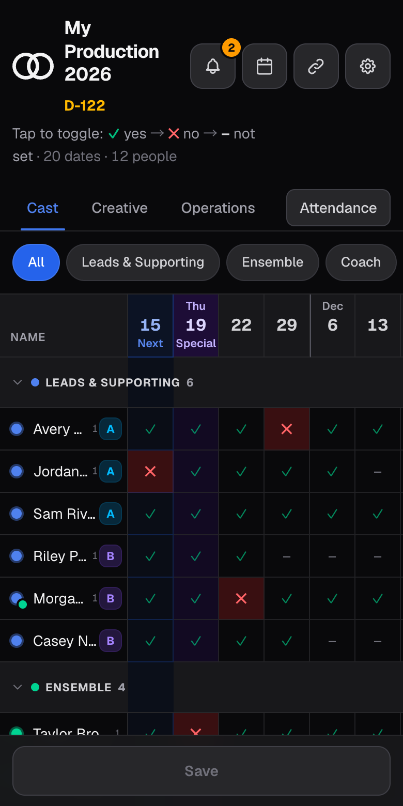
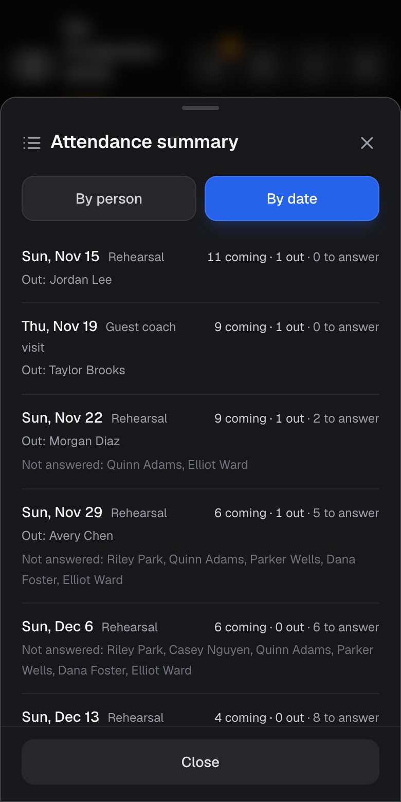
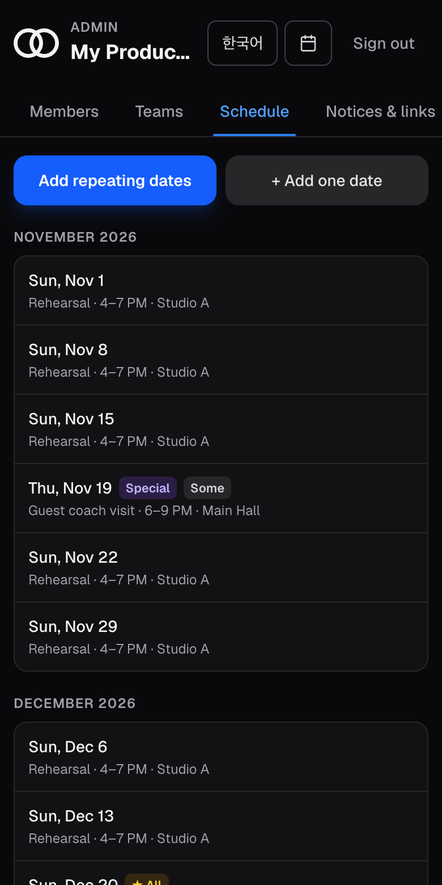
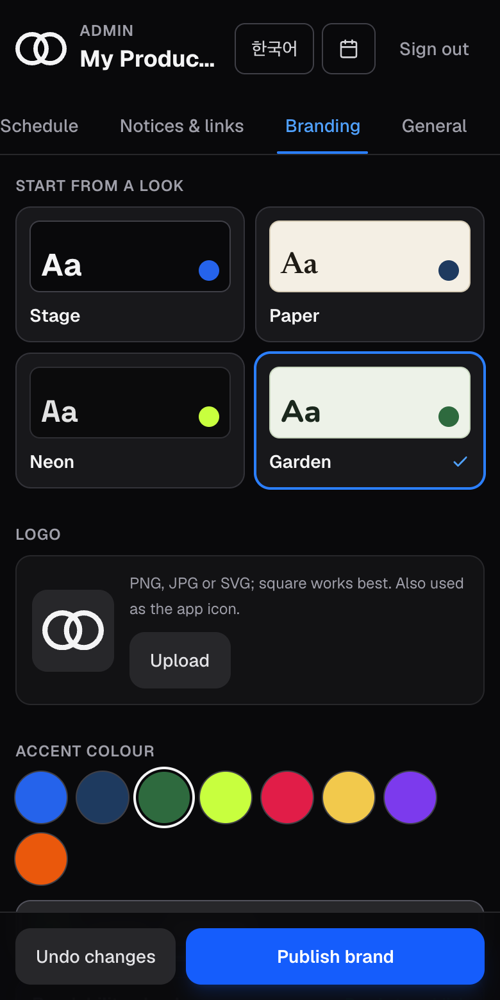

# Rehearsal Scheduler

**Who's coming to rehearsal — at a glance.** A phone-first attendance and schedule app for theatre companies,
choirs, bands, dance crews, or any group that meets on a calendar. Members tap their dates; organisers see who's
coming, who isn't and who hasn't answered. Free to run, yours to brand, no accounts to manage.

<p>
  
  
  
  
</p>

## Try it (no sign-up)

- **Schedule:** https://rehearsal-scheduler-demo.vercel.app — tap any cell, press Save.
- **Admin:** https://rehearsal-scheduler-demo.vercel.app/admin — password `demo-admin`. Add people and teams,
  build a calendar, change the look.

The demo holds a made-up company and resets every day, so nothing you do there can break anything.

## What it does

- **One tap per date.** Each cell is **–** (not answered), **✓** (coming) or **✕** (can't come, with a reason).
- **Teams and roles.** Any number of teams as tabs; a cast can be grouped into leads, ensemble and coaches.
- **A real calendar.** Weekly or fortnightly rehearsals in one go, one-off dates, breaks, venues with map links,
  performances with a countdown, "everyone attends" and special sessions, dates limited to certain teams.
- **For organisers.** Attendance by person and by date, including who still has to answer.
- **A paper trail.** Every save is logged with who changed what; an admin can undo any entry.
- **Your brand.** Logo, colours, fonts and layout from the admin page, with a readability check (WCAG AA) that
  stops a colour choice from making the schedule hard to read.
- **Notices and links.** Key dates, announcements and the links your group opens most.
- **English and Korean**, light and dark, works in Chrome, Safari and Firefox on phones and laptops.

## Get your own (about 10 minutes, no coding)

[](https://vercel.com/new/clone?repository-url=https%3A%2F%2Fgithub.com%2Fmooque-dev%2Frehearsal-scheduler-template&project-name=rehearsal-scheduler&repository-name=rehearsal-scheduler&env=ADMIN_PASSWORD&envDescription=The%20password%20for%20your%20%2Fadmin%20page.%20Choose%20a%20long%20one%20and%20keep%20it%20private.&envLink=https%3A%2F%2Fgithub.com%2Fmooque-dev%2Frehearsal-scheduler-template%2Fblob%2Fmain%2Fdocs%2FGETTING-STARTED.md&stores=%5B%7B%22type%22%3A%22integration%22%2C%22integrationSlug%22%3A%22neon%22%2C%22productSlug%22%3A%22neon%22%2C%22protocol%22%3A%22storage%22%7D%5D)

1. Press the button. Vercel copies this project to your own GitHub account, creates a free database for it and asks
   for one thing: an **admin password**.
2. When it finishes, open `your-site.vercel.app/admin`, sign in and choose **Load the sample** or **Start empty**.
3. Add your teams, people and dates, set your look under **Branding**, and share the link with your group.

New to GitHub or Vercel? **[docs/GETTING-STARTED.md](docs/GETTING-STARTED.md)** walks through every step, including
what to do if the button doesn't set up the database for you.

## Good to know before you share it

- **Anyone with the link can mark anyone's attendance.** That keeps it effortless for a small group; the update log
  and undo are the safety net. Share the link only with your group. If you need more control, turn on your host's
  password protection.
- **Keep the admin password private.** It opens the admin page and lets someone undo log entries. Repeated wrong
  guesses are locked out for ten minutes.
- **It stores first names and attendance only** — no emails, no accounts. Your data lives in your own database.
- **Cost:** the free tiers of Vercel and Neon are enough for a company-sized group.

## Everything you can change on /admin

| Tab | What you can change |
| --- | --- |
| **Members** | Add, edit, reorder and remove people; team, role (leads / ensemble / coach), A/B cast, a second group, a character or position |
| **Teams** | Add, rename (English and Korean), reorder and remove teams; "group by role" splits a team into leads, ensemble and coaches |
| **Schedule** | Repeating dates (weekly or every 2 weeks, between two dates, skipping breaks); single dates (what, time, venue, performance, special session, everyone-attends ★, which teams or roles attend); breaks; venues |
| **Notices & links** | Notices with dates and Markdown-style links (`[Map](https://…)`); the links shown under the Resources button |
| **Branding** | A starting look (Stage, Paper, Neon, Garden), logo (also the app icon and the picture shown when the link is shared), accent colour, background tone, opening theme, fonts, corners, header layout |
| **General** | The name shown on the schedule; whether unanswered cells mean "–" or "✓" |

Moving a date keeps the answers already given. Deleting a date or a member removes their answers.

## For developers

```bash
npm install
cp .env.example .env.local     # DATABASE_URL, ADMIN_PASSWORD (ARCHIVE_PIN optional)
npm run seed                   # creates the tables and loads the sample company
npm run dev                    # http://localhost:3000
```

| Command | Does |
| --- | --- |
| `npm run dev` | Local development server |
| `npm run build` / `npm start` | Production build and server |
| `npm run lint` | ESLint |
| `npm run seed` | Create tables and load the sample company (`-- --reset` to start over) |
| `npm test` | Browser smoke tests in Chrome, Firefox and Safari's engine (needs a seeded database and `npx playwright install`) |

- **Stack:** Next.js 16 (App Router), React 19, Tailwind v4, TypeScript, `pg` (no ORM). Any Postgres works.
- **Data:** only answers are stored (`absences`); a missing row means the default. Every save and undo runs in one
  transaction and writes an `update_log` entry holding the previous values.
- **Seasons:** everything belongs to `_meta.current_season` (default 1). Set it to 2 to start a new season; the old
  one stays readable at `/archive` behind `ARCHIVE_PIN`.
- **Branding:** presets, tones, fonts and the contrast rules live in `lib/brand.ts`. Wording is in `lib/i18n.ts`;
  the placeholder logo in `lib/logoPaths.ts`.
- **Public demo:** `DEMO_MODE=1` shows the admin password on the sign-in screen, adds a banner and a "Reset demo"
  button, keeps uploaded logos on the visitor's device, and (with `CRON_SECRET`) lets the daily job in `vercel.json`
  restore the sample. Without `DEMO_MODE` that job does nothing.
- **CI:** lint, build and the browser tests run on every push (`.github/workflows/ci.yml`).
- `AGENTS.md` / `CLAUDE.md` are hints for AI coding assistants; keep or delete them.

MIT licensed (see `LICENSE`).
